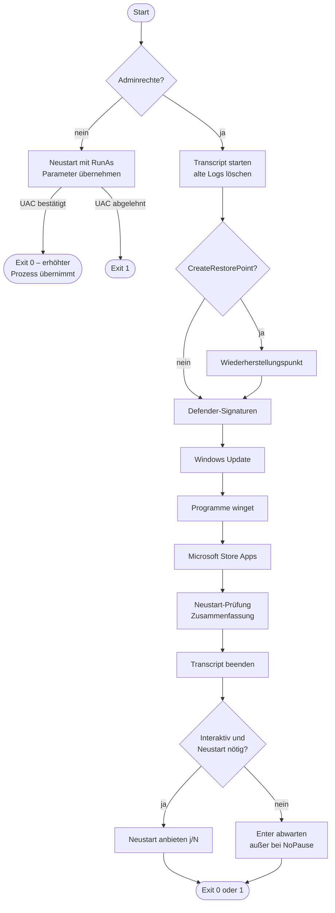

# Update-All.ps1

PowerShell-Script, das einen Windows-PC in einem Durchgang aktuell hält:

- **Microsoft Defender** – Virensignaturen
- **Windows Update** – inkl. Microsoft Update (Office, .NET, PowerShell 7 …), optional Treiber
- **Programme** – alle über `winget` installierbaren Anwendungen
- **Microsoft Store Apps** – stößt die Update-Suche an

Jeder Schritt meldet am Ende einen Status, alles wird in eine Logdatei geschrieben, und wenn Windows einen Neustart verlangt, wird angeboten, ihn direkt durchzuführen.

---

## Inhalt

- [Voraussetzungen](#voraussetzungen)
- [Installation](#installation)
- [Verwendung](#verwendung)
- [Parameter](#parameter)
- [Ablauf im Überblick](#ablauf-im-überblick)
- [Funktionsweise im Detail](#funktionsweise-im-detail)
  - [Architektur](#architektur)
  - [Programmablauf](#programmablauf)
  - [Selbst-Erhöhung (UAC)](#1-selbst-erhöhung-uac)
  - [Schritt-Framework](#2-schritt-framework)
  - [Fehlerbehandlung](#3-fehlerbehandlung)
  - [Protokollierung](#4-protokollierung)
  - [Die einzelnen Schritte](#5-die-einzelnen-schritte)
  - [Neustart-Erkennung](#6-neustart-erkennung)
  - [Abschluss und Exitcode](#7-abschluss-und-exitcode)
- [Status und Exitcode](#status-und-exitcode)
- [Logdateien](#logdateien)
- [Systemänderungen](#systemänderungen)
- [Sicherheitshinweise](#sicherheitshinweise)
- [Bekannte Einschränkungen](#bekannte-einschränkungen)
- [Als geplante Aufgabe ausführen](#als-geplante-aufgabe-ausführen)
- [Pakete von winget ausnehmen](#pakete-von-winget-ausnehmen)
- [Erweiterung: eigenen Schritt hinzufügen](#erweiterung-eigenen-schritt-hinzufügen)
- [Fehlerbehebung](#fehlerbehebung)

---

## Voraussetzungen

| Komponente | Hinweis |
|---|---|
| Windows 10 / 11 | |
| Windows PowerShell 5.1 oder PowerShell 7 | Der Wiederherstellungspunkt funktioniert nur unter 5.1. |
| Administratorrechte | Das Script fordert sie bei Bedarf selbst per UAC an. |
| Internetzugang | Für Updates und für die einmalige Installation von PSWindowsUpdate. |
| winget (App Installer) | Optional – fehlt er, wird der Schritt übersprungen. |
| Microsoft Defender | Optional – ist er nicht aktiv (z. B. Fremd-Virenscanner), wird der Schritt übersprungen. |

Das Modul **PSWindowsUpdate** und der Paketanbieter **NuGet** werden beim ersten Lauf automatisch aus der PowerShell Gallery installiert (für alle Benutzer).

## Installation

1. `Update-All.ps1` in einen festen Ordner legen, z. B. `C:\Scripts\`.
2. Die Datei muss als **UTF-8 mit BOM** gespeichert sein, sonst zeigt Windows PowerShell 5.1 die Umlaute falsch an. In VS Code: unten rechts auf die Codierung klicken → *Mit Codierung speichern* → *UTF-8 with BOM*.
3. Falls die Datei aus dem Internet heruntergeladen wurde, die Sperre aufheben:
   ```powershell
   Unblock-File C:\Scripts\Update-All.ps1
   ```
4. **Ausführungsrichtlinie:** Auf Windows-Clients ist sie standardmäßig `Restricted`. Ein direkter Aufruf wie `.\Update-All.ps1` scheitert dann mit *„… da die Ausführung von Skripts auf diesem System deaktiviert ist“*. Es gibt zwei Möglichkeiten:
   - **Ohne Systemänderung:** Das Script immer über `powershell.exe -NoProfile -ExecutionPolicy Bypass -File …` starten (siehe [Verwendung](#verwendung)).
   - **Richtlinie für das eigene Konto lockern** (ohne Adminrechte möglich), danach funktioniert auch der direkte Aufruf:
     ```powershell
     Set-ExecutionPolicy -ExecutionPolicy RemoteSigned -Scope CurrentUser
     ```

   Gibt eine Gruppenrichtlinie die Ausführungsrichtlinie vor, ist nur die erste Möglichkeit nutzbar. Der Neustart mit Adminrechten setzt immer `-ExecutionPolicy Bypass`, die Richtlinie betrifft also nur den ersten Aufruf.

## Verwendung

**Einfachster Aufruf** (aus einer beliebigen PowerShell oder per Verknüpfung):

```powershell
powershell.exe -NoProfile -ExecutionPolicy Bypass -File "C:\Scripts\Update-All.ps1"
```

Ohne Adminrechte gestartet, öffnet sich eine UAC-Abfrage und das Script startet sich in einem neuen, erhöhten Fenster neu. Alle angegebenen Parameter werden dabei übernommen.

**Beispiele** (der direkte Aufruf mit `.\` setzt die Ausführungsrichtlinie `RemoteSigned` voraus, siehe [Installation](#installation), Schritt 4):

```powershell
# Mit Treibern und vorherigem Wiederherstellungspunkt
.\Update-All.ps1 -IncludeDrivers -CreateRestorePoint

# Auch winget-Pakete mit unbekannter Version aktualisieren
.\Update-All.ps1 -IncludeUnknown

# Ohne Abfrage am Ende, Logs nur 30 Tage aufbewahren
.\Update-All.ps1 -NoPause -LogRetentionDays 30
```

**Desktop-Verknüpfung:** Neue Verknüpfung anlegen und als Ziel eintragen:

```
powershell.exe -NoProfile -ExecutionPolicy Bypass -File "C:\Scripts\Update-All.ps1"
```

## Parameter

| Parameter | Typ | Standard | Beschreibung |
|---|---|---|---|
| `-IncludeDrivers` | Switch | aus | Treiber-Updates über Windows Update mitinstallieren. |
| `-IncludeUnknown` | Switch | aus | winget-Pakete mit unbekannter Version einbeziehen. Kann dazu führen, dass dieselben Pakete bei jedem Lauf erneut „aktualisiert“ werden. |
| `-CreateRestorePoint` | Switch | aus | Vorher einen Wiederherstellungspunkt anlegen. Nur unter Windows PowerShell 5.1, die Systemwiederherstellung muss aktiviert sein. Windows erlaubt standardmäßig höchstens einen Punkt pro 24 Stunden. |
| `-NoPause` | Switch | aus | Am Ende nicht auf Enter warten und keinen Neustart anbieten (für geplante Aufgaben). |
| `-LogRetentionDays` | Zahl (1–3650) | 90 | Logs, die älter sind, werden beim Start gelöscht. Werte außerhalb des Bereichs werden von PowerShell bereits beim Aufruf abgewiesen. |

## Ablauf im Überblick

| # | Schritt | Bedingung | Werkzeug |
|---|---|---|---|
| 1 | Wiederherstellungspunkt | nur mit `-CreateRestorePoint` | `Checkpoint-Computer` |
| 2 | Defender-Signaturen | Defender aktiv | `Update-MpSignature` |
| 3 | Windows Update | immer | Modul PSWindowsUpdate |
| 4 | Programme (winget) | winget vorhanden | `winget upgrade --all` |
| 5 | Microsoft Store Apps | immer | MDM-WMI-Klasse, `UpdateScanMethod` |
| 6 | Neustart-Prüfung, Zusammenfassung | immer | Registrierung |

Scheitert ein Schritt, wird er als *Fehler* markiert und das Script fährt mit dem nächsten fort. Die Details stehen im folgenden Abschnitt.

### Beispiel einer Zusammenfassung

```
== Zusammenfassung ==
Defender-Signaturen        OK - Version 1.421.1234.0 vom 18.11.2026 17:55
Windows Update             OK - 2 Update(s) installiert
Programme (winget)         Warnung - teilweise fehlgeschlagen (Exitcode 0x8A15002C) - Liste oben prüfen
Microsoft Store Apps       OK - Scan angestoßen, Updates laufen im Hintergrund weiter

Neustart ausstehend - bitte neu starten, um die Updates abzuschließen.
```

*(Werte beispielhaft.)*

---

## Funktionsweise im Detail

### Architektur

Das Script ist in klar getrennte Bereiche gegliedert, die nacheinander ausgeführt werden:

| Bereich | Aufgabe |
|---|---|
| **Parameterblock** | `[CmdletBinding()]` mit typisierten, validierten Parametern. |
| **Selbst-Erhöhung** | Prüft Adminrechte und startet das Script bei Bedarf erhöht neu. |
| **Hilfsfunktionen** | `Invoke-Step` und `Set-StepResult` bilden ein kleines Framework, das jeden Update-Schritt isoliert ausführt und sein Ergebnis erfasst. |
| **Protokollierung** | Startet das Transcript und räumt alte Logs auf. |
| **Hauptteil** | Die Update-Schritte, Neustart-Prüfung und Zusammenfassung – umschlossen von `try/catch/finally`. |
| **Abschluss** | Interaktive Abfrage (Neustart oder Enter) und Berechnung des Exitcodes. |

Leitprinzipien des Designs:

- **Fehlerisolierung:** Ein fehlgeschlagener Schritt bricht den Gesamtlauf nicht ab.
- **Eindeutige Ergebnisse:** Jeder Schritt endet mit genau einem von vier Status, der auch maschinell (Exitcode) auswertbar ist.
- **Nachvollziehbarkeit:** Jeder Lauf erzeugt ein eigenes, zeitgestempeltes Log.
- **Keine ungewollten Eingriffe:** Kein automatischer Neustart, keine Vorschau-Updates, keine Treiber ohne ausdrücklichen Schalter.

### Programmablauf



### 1. Selbst-Erhöhung (UAC)

1. Über `WindowsPrincipal.IsInRole(Administrator)` wird geprüft, ob der aktuelle Prozess erhöht läuft. Bei aktiver UAC ist das auch für Mitglieder der Administratorengruppe erst nach Bestätigung der Fall.
2. Falls nicht, wird eine Argumentliste aufgebaut: `-NoProfile -ExecutionPolicy Bypass -File "<Pfad>"` plus alle Parameter aus `$PSBoundParameters`.
   - Gesetzte Switches werden als `-Name` übergeben, nicht gesetzte weggelassen.
   - Werte-Parameter werden als `-Name Wert` übergeben (z. B. `-LogRetentionDays 30`).
3. Der Neustart erfolgt mit `Start-Process -Verb RunAs` und **derselben ausführbaren Datei** wie der aktuelle Prozess (`(Get-Process -Id $PID).Path`). Wer mit `pwsh.exe` startet, bleibt also bei PowerShell 7, wer mit `powershell.exe` startet, bei 5.1.
4. Der ursprüngliche Prozess beendet sich danach sofort mit Exitcode `0`. Lehnt der Benutzer die UAC-Abfrage ab, wirft `Start-Process` eine Ausnahme; das Script meldet den Abbruch und endet mit `1`.

**Warum kein `#Requires -RunAsAdministrator`?** Diese Anweisung würde das Script ohne Adminrechte sofort mit einer Fehlermeldung beenden. Beim Start über eine Verknüpfung schließt sich das Fenster dann, bevor man die Meldung lesen kann.

### 2. Schritt-Framework

Alle Update-Schritte laufen über zwei Funktionen:

```powershell
Invoke-Step 'Name des Schritts' {
    # ... Arbeit ...
    Set-StepResult 'Warnung' 'optionale Erläuterung'
}
```

**`Invoke-Step`**

1. Gibt eine Überschrift `== Name ==` aus.
2. Setzt den Status auf den Standardwert `OK` und die Notiz auf leer.
3. Führt den Scriptblock aus (`& $Action`).
4. Fängt jede abbrechende Ausnahme ab, gibt eine Warnung aus und setzt den Status auf `Fehler` mit der Fehlermeldung als Notiz.
5. Speichert das Ergebnis als Objekt `{ Status; Note }` in der geordneten Hashtable `$results`. Die Reihenfolge der Schritte bleibt dadurch für die Zusammenfassung erhalten.

**`Set-StepResult`**

- Setzt Status und Notiz des laufenden Schritts in Variablen mit Script-Gültigkeit (`$script:StepStatus`, `$script:StepNote`), damit sie aus dem Scriptblock heraus sichtbar sind.
- Der Status ist per `ValidateSet` auf `OK`, `Warnung`, `Übersprungen` und `Fehler` beschränkt – Tippfehler fallen sofort als Fehler auf.

**Konventionen innerhalb eines Schritts:**

| Situation | Umsetzung |
|---|---|
| Erfolg ohne Zusatzinfo | Nichts tun – der Status bleibt `OK`. |
| Erfolg mit Info | `Set-StepResult 'OK' '…'` |
| Nicht anwendbar | `Set-StepResult 'Übersprungen' '…'` gefolgt von `return` (beendet nur den Scriptblock, nicht das Script). |
| Teilerfolg | `Set-StepResult 'Warnung' '…'` |
| Fehlschlag | `throw` – `Invoke-Step` setzt dann `Fehler`. |

### 3. Fehlerbehandlung

Die Fehlerbehandlung ist dreistufig:

| Ebene | Mechanismus | Wirkung |
|---|---|---|
| **Global** | `$ErrorActionPreference = 'Stop'` (gesetzt nach der Selbst-Erhöhung) | Auch nicht abbrechende Fehler von Cmdlets werden zu Ausnahmen und damit zuverlässig abgefangen. Wo ein Fehler erwartet und toleriert wird, steht explizit `-ErrorAction SilentlyContinue`. |
| **Schritt** | `try/catch` in `Invoke-Step` | Ein Fehler betrifft nur den eigenen Schritt. |
| **Hauptteil** | äußeres `try/catch/finally` | Fängt unerwartete Fehler außerhalb der Schritte ab (z. B. in Neustart-Prüfung oder Zusammenfassung), setzt `$fatalError` und stellt im `finally` sicher, dass das Transcript in jedem Fall sauber beendet wird. |

**Externe Programme (winget):** Native Programme lösen bei einem Fehler-Exitcode keine PowerShell-Ausnahme aus. Ihr Ergebnis wird deshalb ausdrücklich über `$LASTEXITCODE` ausgewertet.

**Toleranz gegenüber Nebensächlichem:** Fehler, die den eigentlichen Zweck nicht gefährden – Log nicht anlegbar, alte Logs nicht löschbar, Konsolencodierung nicht umstellbar – führen nur zu einer Warnung bzw. werden ignoriert. Das Script läuft weiter.

### 4. Protokollierung

1. Das Verzeichnis `%ProgramData%\UpdateScript\Logs` wird bei Bedarf angelegt.
2. `Start-Transcript` schreibt ab jetzt die Konsolenausgabe in `Update_JJJJ-MM-TT_HH-mm-ss.log`. Der Dateiname ist sekundengenau und damit pro Lauf eindeutig.
3. Danach werden alle `Update_*.log` gelöscht, deren letzte Änderung älter als `-LogRetentionDays` Tage ist. Das laufende Log ist davon nie betroffen.
4. Ausgaben, die sonst direkt an die Konsole gingen, werden gezielt mit `| Out-Host` durch PowerShell geleitet, damit sie im Transcript landen.
5. Das Transcript endet im `finally` des Hauptteils, **vor** der interaktiven Neustart-Abfrage.

Schlägt das Anlegen des Logs fehl (Ordner, Pfad oder `Start-Transcript`), läuft das Script ohne Log weiter (`$transcriptStarted = $false`), und die Aufräumroutine wird übersprungen.

### 5. Die einzelnen Schritte

#### 5.1 Wiederherstellungspunkt

| | |
|---|---|
| **Aktiv** | nur mit `-CreateRestorePoint` |
| **Umsetzung** | `Checkpoint-Computer -RestorePointType MODIFY_SETTINGS` |
| **Übersprungen** | wenn `Checkpoint-Computer` nicht existiert – das Cmdlet gibt es in PowerShell 7 nicht mehr. |
| **Fehler** | z. B. wenn die Systemwiederherstellung deaktiviert ist. |

Dieser Schritt läuft als erster, damit der Wiederherstellungspunkt den Zustand **vor** allen Änderungen sichert.

#### 5.2 Defender-Signaturen

1. **Vorprüfung:** `Get-MpComputerStatus` liefert keinen Status oder `AMServiceEnabled` ist falsch → *Übersprungen*. Das ist typisch, wenn ein anderer Virenscanner Defender ersetzt.
2. **Update mit Wiederholung:** `Update-MpSignature` wird bis zu dreimal ausgeführt, mit 30 Sekunden Pause zwischen den Versuchen.
3. **Ergebnisprüfung:** Der Status wird erneut gelesen; Signaturversion und -datum stehen in der Notiz.

| Ergebnis | Status |
|---|---|
| Update-Befehl erfolgreich | OK |
| Befehl dreimal gescheitert, Signaturen aber jünger als 24 h | OK (mit Hinweis) |
| Befehl gescheitert und Signaturen älter als 24 h | Fehler |

Bewertet wird also das eigentliche Ziel – **aktuelle Signaturen** – und nicht allein der Rückgabewert des Befehls.

**Warum vor Windows Update?** Installiert Windows Update selbst gerade ein Defender-Signatur-Update, scheitert ein direkt folgendes `Update-MpSignature` häufig mit „Der Remoteprozeduraufruf ist fehlgeschlagen“.

#### 5.3 Windows Update

**Bereitstellung des Moduls** (nur wenn PSWindowsUpdate noch nicht installiert ist):

1. TLS 1.2 wird für den Prozess **zusätzlich** zu den vorhandenen Protokollen aktiviert (bitweises ODER). Ältere 5.1-Installationen können sich sonst nicht mit der PowerShell Gallery verbinden.
2. Fehlt der NuGet-Paketanbieter oder ist er älter als 2.8.5.201, wird er für alle Benutzer installiert.
3. PSWindowsUpdate wird mit `-Scope AllUsers` installiert, also unter `C:\Program Files\…\Modules` statt im Benutzerprofil. So landet es nicht in einem möglicherweise per OneDrive synchronisierten Dokumente-Ordner.

**Suche und Installation** über `Get-WindowsUpdate` mit:

| Parameter | Zweck |
|---|---|
| `-MicrosoftUpdate` | Auch Updates für andere Microsoft-Produkte (Office, .NET, PowerShell 7 …). |
| `-Install -AcceptAll` | Gefundene Updates ohne Rückfrage installieren. |
| `-IgnoreReboot` | Keinen Neustart auslösen oder abfragen – das übernimmt das Script am Ende selbst. |
| `-NotTitle 'Preview\|Vorschau'` | Vorschau-Updates ausschließen (regulärer Ausdruck auf den Titel). |
| `-UpdateType Software` | Nur Software, keine Treiber – entfällt mit `-IncludeDrivers`. |

**Auswertung:** Die Ausgabe wird per `Tee-Object` gleichzeitig angezeigt und in `$wuOutput` gespeichert. PSWindowsUpdate gibt pro Update mehrere Objekte aus (Annahme, Download, Installation); ausgewertet werden nur Objekte mit einer Eigenschaft `Result`, die Titel werden dedupliziert.

| Ergebnis | Status |
|---|---|
| mindestens ein `Result` mit „Failed“ | Warnung – mit Anzahl und Titeln |
| mindestens ein `Result` mit „Installed“ | OK – mit Anzahl |
| keine Ausgabe | OK – „keine Updates gefunden“ |
| sonstiges | OK – „Ergebnis siehe Ausgabe oben“ |

#### 5.4 Programme (winget)

1. **Vorprüfung:** `winget` nicht im Pfad → *Übersprungen*.
2. **Quellen aktualisieren:** `winget source update`; der Exitcode wird gemerkt.
3. **Upgrade:** `winget upgrade --all --silent --disable-interactivity --accept-package-agreements --accept-source-agreements`, optional mit `--include-unknown`. Gepinnte Pakete werden von `--all` nicht angefasst.
4. **Kontrollliste:** Ein zweiter Aufruf `winget upgrade` zeigt, was danach noch offen ist; mit `-IncludeUnknown` wird `--include-unknown` auch hier übergeben. Weil winget in eine Pipeline UTF-8 schreibt, wird `[Console]::OutputEncoding` dafür kurz auf UTF-8 umgestellt und im `finally` zuverlässig zurückgesetzt. Sonst erschienen Umlaute in Windows PowerShell 5.1 als `├╝`.

**Auswertung** (in dieser Reihenfolge):

| Bedingung | Status |
|---|---|
| Upgrade-Exitcode `0x8A15002B` (`APPINSTALLER_CLI_ERROR_UPDATE_NOT_APPLICABLE`) | OK – „keine Updates gefunden“ |
| Upgrade-Exitcode ≠ 0 | Warnung – mit Exitcode in Hex |
| Exitcode der Quellen-Aktualisierung ≠ 0 | Warnung – möglicherweise nicht alle Updates erkannt |
| sonst | OK |

#### 5.5 Microsoft Store Apps

Der Store bietet keinen offiziellen Kommandozeilenbefehl für „alle Apps aktualisieren“. Das Script nutzt deshalb die MDM-Bridge von Windows (WMI/CIM):

- Namespace `root\cimv2\mdm\dmmap`
- Klasse `MDM_EnterpriseModernAppManagement_AppManagement01`
- Methode `UpdateScanMethod`

Das entspricht dem Klick auf „Updates abrufen“ in der Store-Bibliothek. Ein `ReturnValue` ungleich 0 führt zu *Fehler*. Der Aufruf ist **asynchron**: Die Updates laufen danach im Hintergrund, das Script wartet nicht und prüft ihr Ergebnis nicht.

### 6. Neustart-Erkennung

Ein Neustart gilt als ausstehend, wenn mindestens einer dieser Registrierungsschlüssel existiert:

| Schlüssel | Gesetzt von |
|---|---|
| `HKLM:\SOFTWARE\Microsoft\Windows\CurrentVersion\WindowsUpdate\Auto Update\RebootRequired` | Windows Update |
| `HKLM:\SOFTWARE\Microsoft\Windows\CurrentVersion\Component Based Servicing\RebootPending` | Windows-Komponentenwartung (CBS) |

Andere Quellen wie `PendingFileRenameOperations` werden bewusst nicht ausgewertet, weil dieser Wert häufig von beliebigen Installern gesetzt wird und zu Dauer-Hinweisen führen würde.

### 7. Abschluss und Exitcode

1. Die **Zusammenfassung** listet alle Schritte in Ausführungsreihenfolge, farbig nach Status.
2. Das **Transcript** wird beendet, der Logpfad angezeigt.
3. **Interaktiv** gilt der Lauf, wenn `-NoPause` nicht gesetzt ist und `[Environment]::UserInteractive` wahr ist. Dann:
   - mit ausstehendem Neustart: Abfrage `Jetzt neu starten? (j/N)`. Akzeptiert werden `j`, `ja`, `y`, `yes` (unabhängig von Groß-/Kleinschreibung), Standard ist *Nein*. `Restart-Computer` läuft **ohne** `-Force`, damit Programme mit ungespeicherten Daten den Neustart wie gewohnt aufhalten können.
   - ohne Neustart: Warten auf Enter.
4. Der **Exitcode** ist `1`, wenn ein unerwarteter Fehler auftrat oder mindestens ein Schritt *Warnung* oder *Fehler* meldet, sonst `0`.

---

## Status und Exitcode

| Status | Farbe | Bedeutung |
|---|---|---|
| OK | grün | Schritt erfolgreich (oder nichts zu tun). |
| Übersprungen | grau | Schritt nicht anwendbar, z. B. winget fehlt oder Defender nicht aktiv. |
| Warnung | gelb | Teilweise erfolgreich, z. B. einzelne Updates fehlgeschlagen. |
| Fehler | rot | Schritt ist abgebrochen. |

| Exitcode | Bedeutung |
|---|---|
| `0` | Alle Schritte *OK* oder *Übersprungen* – oder das Script hat sich per UAC erhöht neu gestartet (siehe unten). |
| `1` | Mindestens eine *Warnung* oder ein *Fehler*, ein unerwarteter Abbruch – oder die Adminrechte wurden verweigert. |

> **Hinweis:** Startet sich das Script per UAC selbst neu, beendet sich der ursprüngliche Prozess sofort mit `0`. Der echte Exitcode entsteht im neuen, erhöhten Prozess. Wer den Exitcode auswerten will (z. B. in einer geplanten Aufgabe oder einem Deployment-Tool), muss das Script deshalb direkt mit Adminrechten starten.

## Logdateien

Die Konsolenausgabe wird mitgeschrieben unter:

```
%ProgramData%\UpdateScript\Logs\Update_JJJJ-MM-TT_HH-mm-ss.log
```

also normalerweise `C:\ProgramData\UpdateScript\Logs\`. Der Pfad wird am Ende des Laufs angezeigt. Logs, die älter als `-LogRetentionDays` Tage sind (Standard 90), werden beim nächsten Start automatisch gelöscht. Kann kein Log angelegt werden, läuft das Script mit einer Warnung ohne Log weiter.

## Systemänderungen

Neben den eigentlichen Updates nimmt das Script folgende Änderungen am System vor:

| Änderung | Wann |
|---|---|
| Ordner `%ProgramData%\UpdateScript\Logs` und Logdateien | bei jedem Lauf |
| Löschen von Logs älter als `-LogRetentionDays` in diesem Ordner | bei jedem Lauf |
| Paketanbieter NuGet (für alle Benutzer) | einmalig, falls nicht vorhanden |
| PowerShell-Modul PSWindowsUpdate (für alle Benutzer) | einmalig, falls nicht vorhanden |
| Registrierung des Microsoft-Update-Dienstes durch PSWindowsUpdate (`-MicrosoftUpdate`) | falls noch nicht registriert |
| Wiederherstellungspunkt | nur mit `-CreateRestorePoint` |
| Aktualisierung der winget-Quellen | bei jedem Lauf, falls winget vorhanden |

Die TLS-1.2-Einstellung und die Konsolencodierung gelten nur für den laufenden Prozess und werden nicht dauerhaft gespeichert.

## Sicherheitshinweise

- **Ausführungsrichtlinie:** `-ExecutionPolicy Bypass` gilt nur für den gestarteten Prozess und ändert die Richtlinie des Systems nicht. In verwalteten Umgebungen wird empfohlen, das Script zu **signieren** und mit `AllSigned` bzw. `RemoteSigned` zu betreiben.
- **Fremdmodul aus dem Internet:** PSWindowsUpdate stammt aus der öffentlichen PowerShell Gallery und wird mit `-Force` ohne Vertrauensabfrage installiert. Für Unternehmensumgebungen empfiehlt sich, das Modul vorab geprüft über ein internes Repository oder die Softwareverteilung bereitzustellen und die Version festzuschreiben.
- **Automatische Zustimmung:** `-AcceptAll` (Windows Update) sowie `--accept-package-agreements` und `--accept-source-agreements` (winget) akzeptieren Lizenzbedingungen ohne Rückfrage.
- **Adminrechte:** Alle Schritte laufen mit vollen Administratorrechten. Das Script sollte deshalb an einem Ort liegen, an dem Standardbenutzer es nicht verändern können (z. B. `C:\Scripts` mit eingeschränkten Schreibrechten), insbesondere wenn es als geplante Aufgabe mit höchsten Privilegien läuft.
- **Logs:** Die Logdateien enthalten Update-Titel, Paketnamen und Versionen, aber keine Zugangsdaten.

## Bekannte Einschränkungen

| Thema | Beschreibung |
|---|---|
| Exitcode bei Selbst-Erhöhung | Der Exitcode des erhöhten Laufs wird nicht an den Aufrufer zurückgegeben (siehe [Status und Exitcode](#status-und-exitcode)). |
| winget-Ausgabe im Log | Die Live-Ausgabe von `winget upgrade --all` wird nicht durch PowerShell geleitet und erscheint unter Windows PowerShell 5.1 in der Regel nicht im Transcript. Die anschließende Kontrollliste dagegen schon. |
| winget unter SYSTEM | winget ist pro Benutzer installiert und für das SYSTEM-Konto in der Regel nicht auffindbar; der Schritt wird dann übersprungen. |
| Wiederherstellungspunkt | Existiert bereits ein Punkt aus den letzten 24 Stunden, legt Windows keinen neuen an. `Checkpoint-Computer` gibt dann nur eine Warnung aus, der Schritt meldet trotzdem *OK*. |
| Store-Updates | Der Scan wird nur angestoßen; ob die Updates erfolgreich waren, prüft das Script nicht. |
| PSWindowsUpdate-Version | Ein bereits installiertes Modul wird nicht automatisch aktualisiert (manuell: `Update-Module PSWindowsUpdate`). |
| Vorschau-Filter | Erkennt Vorschau-Updates nur an „Preview“ bzw. „Vorschau“ im Titel. |
| Switch-Übergabe | Bei der Selbst-Erhöhung werden nur gesetzte Switches übergeben. Ein explizites `-Schalter:$false` entspricht dem Weglassen und verhält sich daher gleich. |
| Neustart-Erkennung | Berücksichtigt nur Windows Update und CBS, nicht jeden von Installern angeforderten Neustart. |

## Als geplante Aufgabe ausführen

Wichtig dabei:

- **„Mit höchsten Privilegien ausführen“** aktivieren – in einer geplanten Aufgabe kann keine UAC-Abfrage erscheinen, und nur so wird der Exitcode korrekt gemeldet.
- **`-NoPause`** angeben, sonst wartet das Script am Ende auf eine Eingabe.
- Unter einem **normalen Benutzerkonto** (mit Adminrechten) ausführen, nicht als `SYSTEM`, damit winget gefunden wird.

Einrichtung per PowerShell (als Administrator), z. B. jeden Sonntag um 12:00 Uhr:

```powershell
$action   = New-ScheduledTaskAction -Execute 'powershell.exe' `
            -Argument '-NoProfile -ExecutionPolicy Bypass -File "C:\Scripts\Update-All.ps1" -NoPause'
$trigger  = New-ScheduledTaskTrigger -Weekly -DaysOfWeek Sunday -At 12:00
$settings = New-ScheduledTaskSettingsSet -StartWhenAvailable -ExecutionTimeLimit (New-TimeSpan -Hours 3)

Register-ScheduledTask -TaskName 'Update-All' -Action $action -Trigger $trigger `
    -Settings $settings -RunLevel Highest -User $env:USERNAME
```

Mit `-NoPause` wird kein Neustart durchgeführt; ein ausstehender Neustart steht nur in der Zusammenfassung bzw. im Log. Der Exitcode (`0`/`1`) erscheint in der Aufgabenplanung als „Ergebnis der letzten Ausführung“.

## Pakete von winget ausnehmen

Manche Programme aktualisieren sich selbst oder lassen sich mit Adminrechten nicht installieren und erzeugen dann bei jedem Lauf eine Warnung. Diese einmalig per Pin von `winget upgrade --all` ausnehmen:

```powershell
winget pin add --id Spotify.Spotify
winget pin add --id Microsoft.Edge
winget pin add --id Logitech.GHUB
winget pin add --id Ubisoft.Connect
```

Pins anzeigen bzw. wieder entfernen:

```powershell
winget pin list
winget pin remove --id Spotify.Spotify
```

## Erweiterung: eigenen Schritt hinzufügen

Neue Schritte werden im Hauptteil (innerhalb des äußeren `try`) vor dem Block „Neustart ausstehend?“ eingefügt. Status, Fehlerbehandlung, Zusammenfassung und Exitcode funktionieren dann automatisch.

```powershell
Invoke-Step 'Beispiel: Chocolatey' {
    if (-not (Get-Command choco -ErrorAction SilentlyContinue)) {
        Set-StepResult 'Übersprungen' 'Chocolatey nicht installiert'
        return
    }

    choco upgrade all -y
    if ($LASTEXITCODE -ne 0) {
        Set-StepResult 'Warnung' ('Exitcode {0}' -f $LASTEXITCODE)
    }
}
```

Richtlinien:

- Der Schrittname sollte höchstens 26 Zeichen lang sein, damit die Zusammenfassung bündig bleibt.
- Native Programme über `$LASTEXITCODE` auswerten, Cmdlet-Fehler einfach durchlaufen lassen (sie werden durch `$ErrorActionPreference = 'Stop'` zu *Fehler*).
- Ausgaben, die ins Log sollen, mit `| Out-Host` ausgeben.

## Fehlerbehebung

| Problem | Lösung |
|---|---|
| Umlaute werden als `ä` o. Ä. angezeigt | Datei als **UTF-8 mit BOM** speichern. |
| „… da die Ausführung von Skripts auf diesem System deaktiviert ist“ | Mit `-ExecutionPolicy Bypass` starten (siehe [Verwendung](#verwendung)) oder `Set-ExecutionPolicy RemoteSigned -Scope CurrentUser` setzen (siehe [Installation](#installation), Schritt 4). Bei heruntergeladener Datei zusätzlich `Unblock-File` ausführen. |
| Fenster schließt sich sofort | Über eine Verknüpfung mit dem vollständigen `powershell.exe …`-Aufruf starten, nicht per Doppelklick auf die `.ps1`. |
| „Adminrechte wurden nicht erteilt - Abbruch.“ | UAC-Abfrage wurde abgelehnt – erneut starten und bestätigen. |
| Windows Update: Fehler bei der Installation von PSWindowsUpdate | Internetverbindung und Proxy prüfen; ggf. einmal manuell `Install-Module PSWindowsUpdate -Scope AllUsers` ausführen. |
| Wiederherstellungspunkt *Übersprungen* | Script läuft unter PowerShell 7 – mit `powershell.exe` (5.1) statt `pwsh.exe` starten. |
| Wiederherstellungspunkt *Fehler* | Systemwiederherstellung für Laufwerk C: aktivieren (`sysdm.cpl` → Computerschutz). |
| Defender *Fehler* mit „Remoteprozeduraufruf fehlgeschlagen“ | Meist läuft parallel ein Signatur-Update; einige Minuten warten und erneut starten. |
| winget *Warnung* | In der Liste „Nach dem Lauf noch offen“ nachsehen, welches Paket hängt, und es ggf. pinnen (siehe oben). Den Exitcode in der [winget-Dokumentation](https://github.com/microsoft/winget-cli/blob/master/doc/windows/package-manager/winget/returnCodes.md) nachschlagen. |
| winget immer wieder dieselben „Updates“ | `-IncludeUnknown` weglassen. |
| Microsoft Store Apps *Fehler* | Prüfen, ob der Store-Dienst läuft und der Store nicht per Richtlinie deaktiviert ist. |